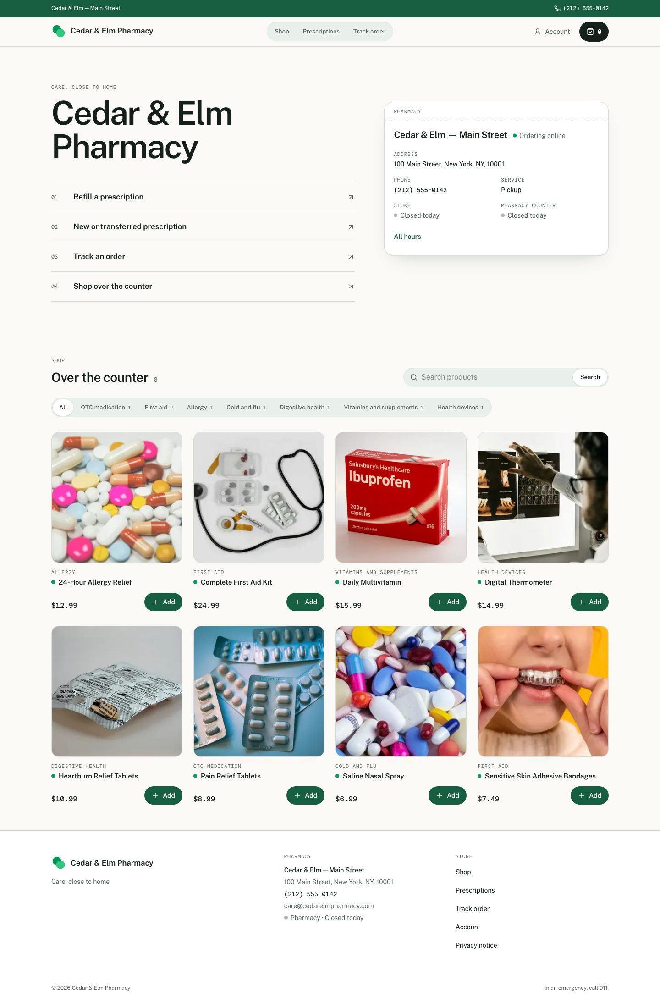
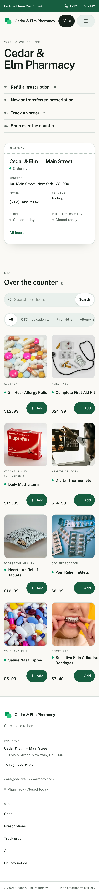
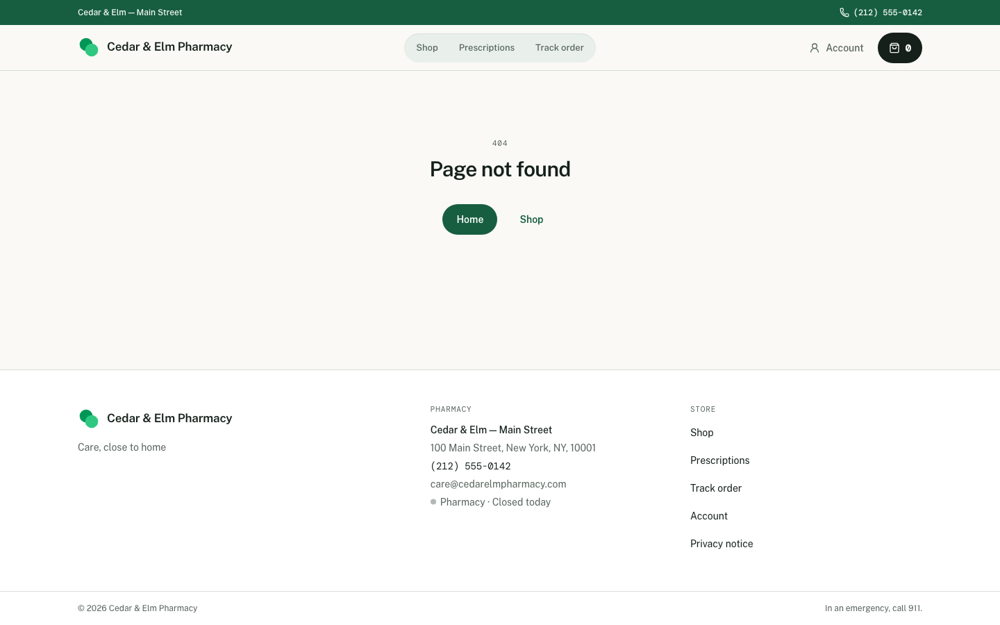
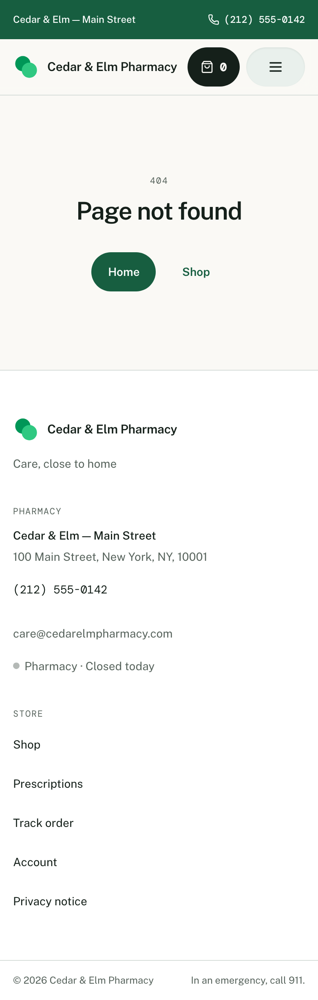

# Blister card at night: pharmacy storefront redesign, 2026-10-25

Live: https://openfront-pharmacy-production.up.railway.app  
Commits (master, auto-deployed on Railway): e54ebbb, 4384c18, 67efb65, 0fe2557, 91b687a  
Brief: `~/Code/Euler/state/briefs/design-skills-redesign-2026-10-25.md` (Openfront Batch 3, storefront only)

## The world
The storefront is a blister card printed at night: a near-black ground and a card-stock field in the store's hue, clear domes holding the counter services and every product, dotted perforations shared between cells, and one bright accent from the store hue for the primary action. Schibsted Grotesk throughout.

Owner bar applied: dark, considered and premium; no grey washed-out ground; no generic SaaS cards; no gradient or glow; UI copy is labels, states and errors only; phone width works. Tessier (dark editorial poster, objects floating on near-black, one display voice used sparingly) was the reference.

## What changed (presentation only; every route, state and workflow kept)
- Home: a full-bleed card-stock chapter with the operator name, the tagline and the location label, and a 2x2 blister of Refill a prescription, New or transferred prescription, Track an order and Shop over the counter as square domes that press in once and push through when pressed.
- Catalog on the card stock with photos filling their domes; long names wrap on phone; prices use proportional figures.
- Prescriptions, order status, account, sign in, cart, checkout and privacy panels sit on the card stock inside the shared perforation, not grey cards; labels above headings moved under them or into the record.
- Phone add-to-cart bar opaque with a perforated edge; a perforated seam above the footer.

Routes captured: /, /products, /products/[handle], /prescriptions, /order-status, /account, /cart (checkout and privacy share the kit).

## Skills used, and how
- **Impeccable** (pbakaus): `impeccable context` loaded project state; `init` wrote `PRODUCT.md` (facts inferred from the repo and the brief, marked as inferred, because the brief ordered no approval stage); `concept-seed --scope direction --mode persuade` rolled the direction against my own ranked list of seven grounded candidates (the roll picked which one to build; challengers were weighed and their disciplines raised into the contract); the direction contract lives in `.impeccable/surfaces/features-storefront.md`; `reference/craft-floor.md` set the build floor; the shipped **impeccable-finish-reviewer** ran a full review, then a verdict pass on the fixes; the **impeccable-documenter** wrote `DESIGN.md` and `.impeccable/design.json` from the shipped code. No image generation was available, so the build was code-led (no comps) and the decision page was skipped (the brief said not to stop for approval).
- **design-taste-frontend** (Leon, tasteskill v2): `draw.mjs` dealt three directions and the full sheet of the chosen one (composition, type system, section blueprints), with slots redrawn only for stated reasons (listed below); the house rules (no eyebrows above headings, no monospace, no tracked tiny capitals, no gradients or glass, no index numbers, two faces at most, 13px type floor) and `lint.mjs` as a gate (0 FAIL on the storefront; deliberate world rules are marked `taste-skill-ignore` with the reason).
- **emil-design-eng**: custom ease-out `cubic-bezier(0.23, 1, 0.32, 1)`, press feedback on every control, hover gated to `(hover: hover) and (pointer: fine)`, entrances from an already-visible default, motion under `prefers-reduced-motion`.
- **frontend-design**: the anti-default calibration (no cream plus serif, no neon on black, no SaaS card kit) and the rule of one bold move per page.
- **high-end-visual-design** and **minimalist-ui** were read; both are opt-in light styles that conflict with the owner's pinned dark direction, so only their restraint on copy and components was used.
- Not used: gpt-taste, creative-director, brand-extract, brandkit, color-expert, animate, prototype, break-ui, mobile-native, pick-ui-library, hallmark, apple-design, taste-design.

Taste-skill direction for this repo: colour-chapters (full-bleed card-stock chapters); type redrawn once because the dealt face is Fontshare-only, giving Schibsted Grotesk.

## Gates (final state)
- Typecheck: `tsc --noEmit -p .` through `heavy-exec.py`, child exit 0, 0 errors, after every batch.
- Parity: `python3 -I platform-parity-audit-2026-10-20/parity-check.py` exit 0, drift 0, missing 0, sidebar-branding ok, sidebar-structure ok, after every batch. Only storefront files changed; the shared dashboard shell and platform pages are untouched.
- Live CSS checked for selectors that exist only in the new stylesheet after each deploy (guards against the Railway stale-compile issue).
- Every route below returned 200 (or the intended 404) on the live site with no horizontal overflow at 1440 and 390.

## Finish review
- Round 1 (fresh impeccable-finish-reviewer): disposition **fix**, with a material-fix list. Every item was applied in one batch, typechecked, parity-checked, pushed and recaptured.
- Round 2 (verdict pass on the recaptures): the remaining partials and small regressions it named were fixed in a final batch. The Impeccable documenter then wrote `DESIGN.md` and `.impeccable/design.json` from the shipped code, and the drift it flagged was cleaned up in the last commit. Two rounds is Impeccable's budget for an unattended run, so no third review ran. The final state hasn't been reviewer-certified as **ship**.

## Open items
- The Refill and Transfer cells on /prescriptions are card-stock panels rather than press-through domes. The reviewer marked this advisory, not blocking.

## Before and after
Before: the live site at the start of this work. These shots are on the demo data that existed then; a separate session reset and re-seeded every demo store the same afternoon, so the store name and catalog differ from the after shots.

After (live, 1440 desktop and 390 phone, full page):

- [after-account-desktop.png](design/redesign-20261025/after-account-desktop.png)
- [after-account-phone.png](design/redesign-20261025/after-account-phone.png)
- [after-cart-desktop.png](design/redesign-20261025/after-cart-desktop.png)
- [after-cart-phone.png](design/redesign-20261025/after-cart-phone.png)
- [after-home-desktop.png](design/redesign-20261025/after-home-desktop.png)
- [after-home-phone.png](design/redesign-20261025/after-home-phone.png)
- [after-order_status-desktop.png](design/redesign-20261025/after-order_status-desktop.png)
- [after-order_status-phone.png](design/redesign-20261025/after-order_status-phone.png)
- [after-prescriptions-desktop.png](design/redesign-20261025/after-prescriptions-desktop.png)
- [after-prescriptions-phone.png](design/redesign-20261025/after-prescriptions-phone.png)
- [after-products-desktop.png](design/redesign-20261025/after-products-desktop.png)
- [after-products-phone.png](design/redesign-20261025/after-products-phone.png)
- [after-products_allergy_relief_tablets-desktop.png](design/redesign-20261025/after-products_allergy_relief_tablets-desktop.png)
- [after-products_allergy_relief_tablets-phone.png](design/redesign-20261025/after-products_allergy_relief_tablets-phone.png)

Product facts are in `PRODUCT.md`, the direction contract is in `.impeccable/surfaces/features-storefront.md`, and the recorded system is in `DESIGN.md`.
